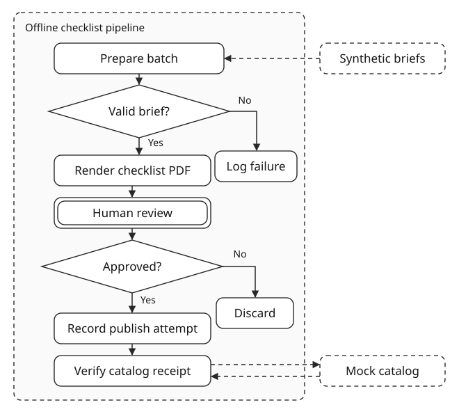

# Checklist Production Pipeline Demo

An offline reference implementation for shipping downloadable checklists with batch preparation, human review and a verified catalog receipt.



## Run

Use Python 3.10 or later. The demos and tests use the standard library.

```sh
python pipeline.py checklist.pdf
python -m unittest -v
```

The demo prepares two checklists from fictional research notes and rejects a malformed third brief. The command saves the first PDF for inspection. It simulates a reviewer approving that exact PDF and discarding the other, then simulates a lost response after the mock catalog writes the approved product. A restarted process verifies the existing catalog entry.

## Workflow

- Prepare up to eight drafts concurrently. Invalid briefs get individual results and a durable validation event without blocking valid items.
- Render a one-page PDF and key reviews by its SHA-256 digest. An edited PDF needs its own decision. Duplicate submissions keep the existing decision.
- Record an explicit reviewer and approval or discard decision before any publication. The example supplies a fictional reviewer.
- Journal the attempt before writing. Retry checks the catalog first. Matching bytes complete the product; conflicting bytes keep it unresolved.

The generation step deterministically turns synthetic notes into checklist items. The catalog is a separate local SQLite database. The demo models the production workflow's handoffs without requiring an AI service, messaging account, external renderer or commerce provider.

[MIT License](LICENSE), copyright PrivateData.
